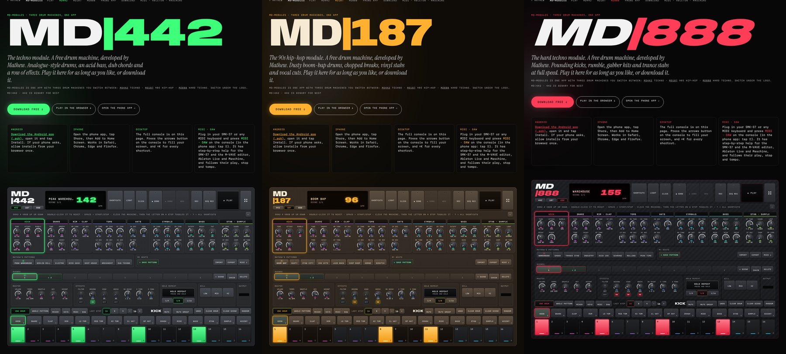
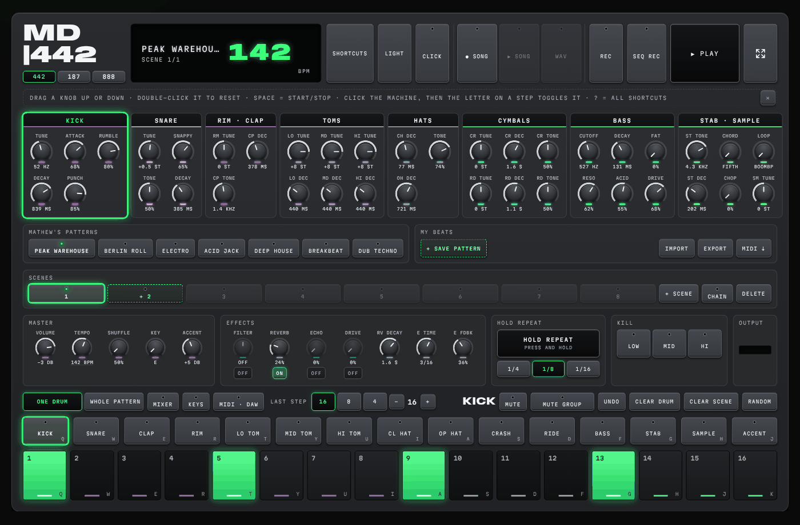
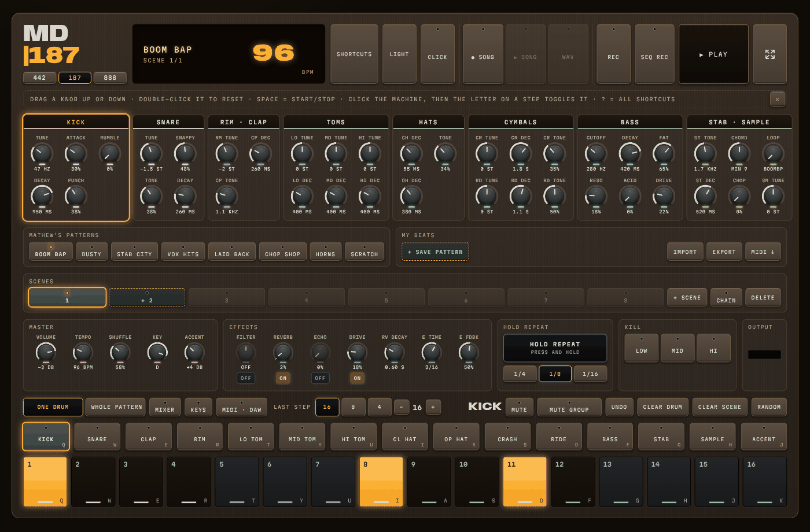
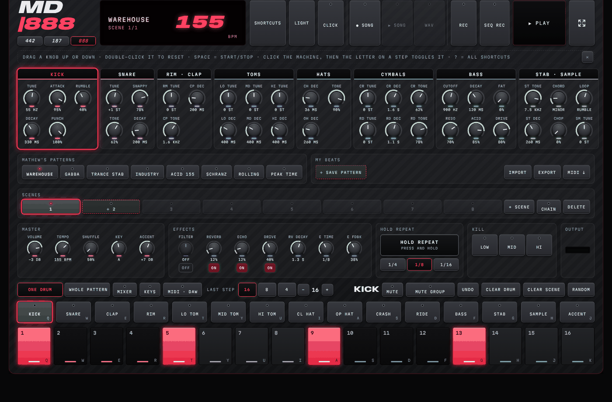
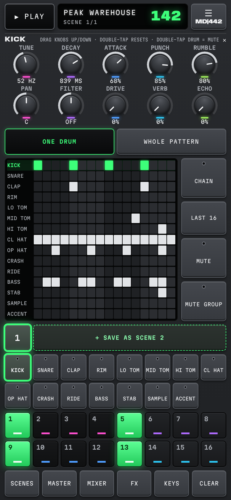

<div align="center">

<a href="https://music.nestgroup.space/md442/"></a>

# MD-Modules

**Three drum machines, one app. Free and open source.**

`MD|442` techno and house &nbsp;·&nbsp; `MD|187` 90s hip-hop &nbsp;·&nbsp; `MD|888` hard techno

[](https://music.nestgroup.space/md442/)
[](https://music.nestgroup.space/md442/download/)
[](LICENSE)
[](samples/LICENSE)

</div>

MD-Modules is a drum machine developed by Mathew at NEST Group: analogue-style drums, an acid bass, dub chords,
a sampler and a row of effects, with a 16-step sequencer, scenes and song recording. The same instrument runs
five ways:

| | Where it runs | Get it |
| --- | --- | --- |
| **Web app** | Any modern browser, nothing to install | [music.nestgroup.space/md442](https://music.nestgroup.space/md442/) |
| **Phone app** | Android (.apk), iPhone (Add to Home Screen) | [Download page](https://music.nestgroup.space/md442/download/) |
| **Desktop app** | Mac (Apple Silicon and Intel), Windows 10 and 11 | [Desktop release](https://github.com/mathewdunn89-ggw/MD-MODULE/releases/tag/desktop) |
| **DAW plugin** | VST3 and AU on Mac, VST3 on Windows, plus a standalone app | [Plugin release](https://github.com/mathewdunn89-ggw/MD-MODULE/releases/tag/plugin) |
| **Keyboard firmware** | M-VAVE SMK-37 Elite, SMK-37 Pro and FM-1, no computer needed | [Firmware releases](https://github.com/mathewdunn89-ggw/MD-MODULE/releases) |

"442" is binary for NEST.

## Contents

- [The three machines](#the-three-machines)
- [Downloads](#downloads)
- [Sample packs](#sample-packs)
- [Install](#install)
- [Keyboard firmware](#keyboard-firmware)
- [Controls and keyboard mapping](#controls-and-keyboard-mapping)
- [Build from source](#build-from-source)
- [Where the code lives](#where-the-code-lives)
- [Contributing](#contributing)
- [Licence and credits](#licence-and-credits)

## The three machines

One console, three sounds. Switch under the logo, or open a machine by its own link.

| Machine | Style | Tempo | Patterns |
| --- | --- | --- | --- |
| [**MD\|442**](https://music.nestgroup.space/md442/) | Techno and house | 142 | Peak Warehouse, Berlin Roll, Electro, Acid Jack, Deep House, Breakbeat, Dub Techno |
| [**MD\|187**](https://music.nestgroup.space/md187/) | 90s hip-hop: boom bap, dusty drums, stabs, vocal hits | 96 | Boom Bap, Dusty, Stab City, Vox Hits, Laid Back, Chop Shop, Horns, Scratch |
| [**MD\|888**](https://music.nestgroup.space/md888/) | Hard techno: warehouse, gabba, rumble, trance stabs | 155 | Warehouse, Gabba, Trance Stab, Industry, Acid 155, Schranz, Rolling, Peak Time |

<p align="center">
  
</p>

<table>
  <tr>
    <td width="50%"></td>
    <td width="50%"></td>
  </tr>
  <tr>
    <td align="center"><b>MD|187</b> · 90s hip-hop</td>
    <td align="center"><b>MD|888</b> · hard techno</td>
  </tr>
</table>

### Each machine's own downloads

| | <a name="md442"></a>MD\|442 | <a name="md187"></a>MD\|187 | <a name="md888"></a>MD\|888 |
| --- | --- | --- | --- |
| **Play it** | [music.nestgroup.space/md442](https://music.nestgroup.space/md442/) | [music.nestgroup.space/md187](https://music.nestgroup.space/md187/) | [music.nestgroup.space/md888](https://music.nestgroup.space/md888/) |
| **Desktop app** | [Mac](https://github.com/mathewdunn89-ggw/MD-MODULE/releases/download/desktop/md442-mac.dmg) · [Windows](https://github.com/mathewdunn89-ggw/MD-MODULE/releases/download/desktop/md442-windows.exe) | [Mac](https://github.com/mathewdunn89-ggw/MD-MODULE/releases/download/desktop/md187-mac.dmg) · [Windows](https://github.com/mathewdunn89-ggw/MD-MODULE/releases/download/desktop/md187-windows.exe) | [Mac](https://github.com/mathewdunn89-ggw/MD-MODULE/releases/download/desktop/md888-mac.dmg) · [Windows](https://github.com/mathewdunn89-ggw/MD-MODULE/releases/download/desktop/md888-windows.exe) |
| **Keyboard firmware 1.8** | [Elite](https://music.nestgroup.space/md442/fw/1.8/md442-smk37-elite.fwsc) · [Pro](https://music.nestgroup.space/md442/fw/1.8/md442-smk37-pro.fwsc) · [FM-1](https://music.nestgroup.space/md442/fw/1.8/md442-fm1.fwsc) | [Elite](https://music.nestgroup.space/md442/fw/1.8/md187-smk37-elite.fwsc) · [Pro](https://music.nestgroup.space/md442/fw/1.8/md187-smk37-pro.fwsc) · [FM-1](https://music.nestgroup.space/md442/fw/1.8/md187-fm1.fwsc) | [Elite](https://music.nestgroup.space/md442/fw/1.8/md888-smk37-elite.fwsc) · [Pro](https://music.nestgroup.space/md442/fw/1.8/md888-smk37-pro.fwsc) · [FM-1](https://music.nestgroup.space/md442/fw/1.8/md888-fm1.fwsc) |
| Previous firmware 1.7 (fallback) | [Elite](https://music.nestgroup.space/md442/fw/1.7/md442-smk37-elite.fwsc) · [Pro](https://music.nestgroup.space/md442/fw/1.7/md442-smk37-pro.fwsc) · [FM-1](https://music.nestgroup.space/md442/fw/1.7/md442-fm1.fwsc) | [Elite](https://music.nestgroup.space/md442/fw/1.7/md187-smk37-elite.fwsc) · [Pro](https://music.nestgroup.space/md442/fw/1.7/md187-smk37-pro.fwsc) · [FM-1](https://music.nestgroup.space/md442/fw/1.7/md187-fm1.fwsc) | [Elite](https://music.nestgroup.space/md442/fw/1.7/md888-smk37-elite.fwsc) · [Pro](https://music.nestgroup.space/md442/fw/1.7/md888-smk37-pro.fwsc) · [FM-1](https://music.nestgroup.space/md442/fw/1.7/md888-fm1.fwsc) |
| **Sample pack** | No loops of its own | [MD187-sample-pack.zip](https://github.com/mathewdunn89-ggw/MD-MODULE/releases/download/sample-packs/MD187-sample-pack.zip) | [MD888-sample-pack.zip](https://github.com/mathewdunn89-ggw/MD-MODULE/releases/download/sample-packs/MD888-sample-pack.zip) |

The phone app and the plugin carry all three machines in one download.

What is on the console:

- **14 voices**: kick, snare, clap, rim, three toms, closed and open hat, crash, ride, bass, stab (chords) and a sampler.
- **16 steps, 8 scenes, chain and song**: record a whole set and save it as a WAV.
- **Effects**: filter, reverb, echo, drive, hold repeat and low / mid / high kills.
- **MIDI**: plug in any USB MIDI keyboard or pad controller. It follows and sends play, stop and tempo with
  Ableton Live and Maschine.
- **Beats travel**: export a beat as `.md442.json` or MIDI, open it in the plugin, or send it to the keyboard.



### On a phone

The phone console is the same engine laid out for one hand: knobs for the drum you picked, the whole pattern
as a grid, and 16 step pads.

- **Android**: download the `.apk` from the [download page](https://music.nestgroup.space/md442/download/), open it
  and tap Install.
- **iPhone**: open the [phone app](https://music.nestgroup.space/md442/app/) in Safari, tap Share, then
  Add to Home Screen.

It works offline once it is installed.

<br clear="right">

## Downloads

| Download | File |
| --- | --- |
| Desktop app, Mac | [md442-mac.dmg](https://github.com/mathewdunn89-ggw/MD-MODULE/releases/download/desktop/md442-mac.dmg) |
| Desktop app, Windows | [md442-windows.exe](https://github.com/mathewdunn89-ggw/MD-MODULE/releases/download/desktop/md442-windows.exe) |
| Plugin, Mac (VST3 + AU) | [md442-plugin-mac.pkg](https://github.com/mathewdunn89-ggw/MD-MODULE/releases/download/plugin/md442-plugin-mac.pkg) |
| Plugin, Windows (VST3) | [md442-plugin-windows.exe](https://github.com/mathewdunn89-ggw/MD-MODULE/releases/download/plugin/md442-plugin-windows.exe) |
| Android app | [md442.apk](https://music.nestgroup.space/api/md442.apk) |
| Keyboard firmware (MD442, MD187, MD888) | [Releases](https://github.com/mathewdunn89-ggw/MD-MODULE/releases), files named `md-hardware` |
| Sample packs | [MD187](https://github.com/mathewdunn89-ggw/MD-MODULE/releases/download/sample-packs/MD187-sample-pack.zip) · [MD888](https://github.com/mathewdunn89-ggw/MD-MODULE/releases/download/sample-packs/MD888-sample-pack.zip) |

The desktop apps and the plugin are not code-signed yet, so macOS and Windows warn the first time you open them.
The install steps below show how to get past that.

## Sample packs

The MD|187 and MD|888 loops are free to download and use in your own tracks.

| Pack | What is inside | Download |
| --- | --- | --- |
| **MD187**, 90s hip-hop, 96 BPM | BOOMBP, DRUMS, STABS, VOX: 4 loops and 32 slices | [MD187-sample-pack.zip](https://github.com/mathewdunn89-ggw/MD-MODULE/releases/download/sample-packs/MD187-sample-pack.zip) |
| **MD888**, hard techno, 155 BPM | RUMBLE, GABBA, TRANCE, HITS: 4 loops and 32 slices | [MD888-sample-pack.zip](https://github.com/mathewdunn89-ggw/MD-MODULE/releases/download/sample-packs/MD888-sample-pack.zip) |

- WAV, 44.1 kHz, 16-bit, mono. Each loop is cut into 8 equal slices and every slice starts on a hit.
- **Every sound is synthesised from scratch** by [`tools/gen_banks.py`](tools/gen_banks.py). Nothing is recorded,
  and nothing is taken from a record or from another product.
- **Licence: [CC0 1.0](samples/LICENSE)**. Use them in any track, commercial or not, with no credit needed.

The loops are also in [`samples/`](samples/). To rebuild the packs yourself: `python3 tools/make_sample_packs.py`.

## Install

**Web**: open [music.nestgroup.space/md442](https://music.nestgroup.space/md442/) and press PLAY.

**Mac desktop app**: open the `.dmg` and drag MD-442 into Applications. The first time, macOS says it cannot
check the app: open System Settings, Privacy & Security, scroll down and click Open Anyway.

**Windows desktop app**: run the `.exe`. If SmartScreen says "Windows protected your PC", click More info,
then Run anyway.

**Plugin**: run the installer, then rescan plugins in your DAW. MD-442 shows up under NEST Group. The full guide
for Ableton Live, Maschine and Logic Pro is in [`plugin/INSTALL.md`](https://github.com/mathewdunn89-ggw/MD-MODULE/blob/vst-plugin/plugin/INSTALL.md).

## Keyboard firmware

MD|442, MD|187 and MD|888 also run on the keyboard itself: no computer, sound from the keyboard's own audio out.

| Your hardware | Files |
| --- | --- |
| M-VAVE SMK-37 Elite | `md442-smk37-elite.fwsc`, `md187-smk37-elite.fwsc`, `md888-smk37-elite.fwsc` |
| M-VAVE SMK-37 Pro (also Starrykey 37 Play) | `md442-smk37-pro.fwsc`, `md187-smk37-pro.fwsc`, `md888-smk37-pro.fwsc` |
| M-VAVE FM-1 | `md442-fm1.fwsc`, `md187-fm1.fwsc`, `md888-fm1.fwsc` |

> [!WARNING]
> This replaces the keyboard's firmware. You can always go back to M-VAVE's own firmware, but you install it at
> your own risk. Use a USB data cable, plug straight into the computer (no hub) and keep the keyboard connected
> until the installer says Done.

**Install on a Mac, about 2 minutes**

1. Download `md-hardware.zip` from the newest [md-hardware release](https://github.com/mathewdunn89-ggw/MD-MODULE/releases) and unzip it.
2. Connect the keyboard with a USB data cable. Quit any DAW and any browser tab that has MD|442 open.
3. Double-click **Install MD Hardware (Mac).command**. The first time, macOS may block it: right-click it,
   choose Open, then Open again.
4. Pick the firmware (MD442, MD187 or MD888), then your keyboard. The installer checks that the file matches the
   connected keyboard before it writes anything.
5. Wait for Done. The keyboard restarts into the firmware you picked.

**Windows or Linux**

```sh
pip install mido python-rtmidi
python3 tools/fm1_install.py md442-smk37-elite.fwsc
```

**Go back to the stock firmware**: hold OCTAVE- and OCTAVE+ together for 5 seconds to put the keyboard in update
mode, then install M-VAVE's own package for your model with M-VAVE's updater (M-UPGRADE). This repository does
not include M-VAVE's firmware; get it from M-VAVE.

Full guides: [`variants/INSTALL.md`](variants/INSTALL.md) (all three firmwares) and
[`firmware/INSTALL.md`](firmware/INSTALL.md) (MD|442 version history).

## Controls and keyboard mapping

The short version for the SMK-37 Elite on firmware 1.8. The whole map, plus the computer keyboard and the plugin's MIDI notes,
is in [`docs/keyboard-mapping.md`](docs/keyboard-mapping.md), and there is a one-page
[cheat sheet (PDF)](variants/md-hardware-controls.pdf).

| Control | What it does |
| --- | --- |
| **< / >** | Pick the instrument: DRUMS 1 (909), DRUMS 2 (808), BASS, CHORDS, LEAD, BREAKS |
| **Keys** (F3 to G5) | Always play the instrument on screen. BASS, CHORDS and LEAD stay in the key of the bass line |
| **ARP** | Arpeggiator for the keys on BASS, CHORDS and LEAD, in time with the pattern |
| **PATCH + SCALE** | IN KEY on / off |
| **Pads 1 to 16** | The 16 steps: tap on, tap off |
| **REC + PLAY** | What you play goes into the pattern on the nearest step |
| **FX** | Switches the faders. Lit: reverb, delay, drive, filter. Off: volumes |
| **Hold a pad + a fader** | That pad's instrument volume |
| **KNOB BANK** | Tap: the pads become mutes. Hold + K2 / K3 / K4: filter, resonance, decay |
| **PATCH + < / >** | Previous or next pattern, at the end of the bar |
| **C3 to E3** | Beat repeat 1/2, 1/4, 1/8, 1/16 and FILL (hold) |
| **G#5 to C6** | ECHO throw, KILL LOW, WASH, RISER, DROP (hold) |

In the web and desktop apps: **Space** starts and stops, **?** or **⌘K / Ctrl+K** lists every shortcut.

## Build from source

Short version below. Details and troubleshooting: [`docs/build-from-source.md`](docs/build-from-source.md).

**Web app** (no build step, plain HTML, CSS and JavaScript):

```sh
git clone -b site https://github.com/mathewdunn89-ggw/MD-MODULE && cd MD-MODULE
python3 -m http.server 8000      # then open http://localhost:8000/md442/
```

**Desktop app** (Electron):

```sh
git clone -b desktop-apps https://github.com/mathewdunn89-ggw/MD-MODULE && cd MD-MODULE/desktop
npm install && node fetch-web.js && npm start
```

**Plugin** (JUCE 8, CMake 3.22 or newer):

```sh
git clone -b vst-plugin https://github.com/mathewdunn89-ggw/MD-MODULE && cd MD-MODULE/plugin
cmake -B build -DCMAKE_BUILD_TYPE=Release && cmake --build build --config Release
```

**Firmware**: two patches on top of the open X0X firmware. GitHub Actions builds all nine files on every push
(see [`.github/workflows/variants.yml`](.github/workflows/variants.yml)), so the simplest way to build is to fork
and push.

**Sample packs**: `pip install numpy scipy && python3 tools/make_sample_packs.py`

## Where the code lives

| Part | Branch | Folder |
| --- | --- | --- |
| Firmware patches, installer, cheat sheets | [`main`](https://github.com/mathewdunn89-ggw/MD-MODULE/tree/main) | `firmware/`, `variants/` |
| Sample generator and loops | [`main`](https://github.com/mathewdunn89-ggw/MD-MODULE/tree/main) | `tools/`, `samples/` |
| Android wrapper | [`main`](https://github.com/mathewdunn89-ggw/MD-MODULE/tree/main) | `android/` |
| Web app, phone app, download and install pages | [`site`](https://github.com/mathewdunn89-ggw/MD-MODULE/tree/site) | `md442/` |
| Desktop app | [`desktop-apps`](https://github.com/mathewdunn89-ggw/MD-MODULE/tree/desktop-apps) | `desktop/` |
| DAW plugin | [`vst-plugin`](https://github.com/mathewdunn89-ggw/MD-MODULE/tree/vst-plugin) | `plugin/` |

## Contributing

Bug reports, patterns, sounds and pull requests are welcome. Start with [CONTRIBUTING.md](CONTRIBUTING.md).
The two rules that matter most: sounds must be your own or synthesised (nothing from a record or from another
product), and firmware changes say whether they were tested on a real keyboard.

## Licence and credits

- **Code**: [GPL-3.0](LICENSE). The firmware is built on GPL-3.0 work, so it stays GPL-3.0.
- **Samples**: [CC0 1.0](samples/LICENSE).
- **Firmware lineage**: [X0X](https://github.com/genkigenki/fm1-x0x) by Charles Vestal, a fork of Felucca by
  Leo Kuroshita (Hügelton Instruments), with the SMK-37 port by genkigenki. The MD changes are
  [`firmware/md442-smk37.patch`](firmware/md442-smk37.patch) then
  [`variants/md-variants.patch`](variants/md-variants.patch), against `genkigenki/fm1-x0x` at `8af3731`.
- **Plugin**: built with [JUCE](https://juce.com). **Desktop app**: built with [Electron](https://www.electronjs.org).

MD-Modules is an independent project. It is not affiliated with or endorsed by M-VAVE, Ableton, Native Instruments,
Apple or Roland; their names are used only to say what MD-Modules works with.

Developed by Mathew · [NEST Group](https://music.nestgroup.space/md442/)
